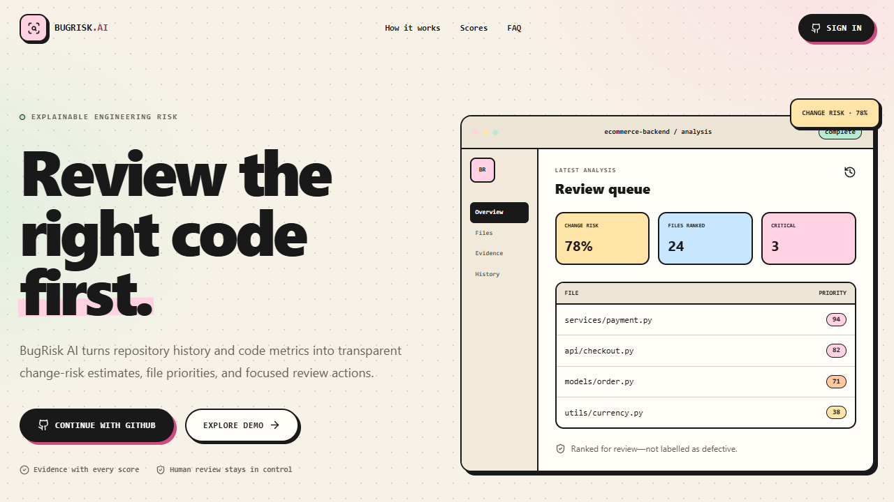
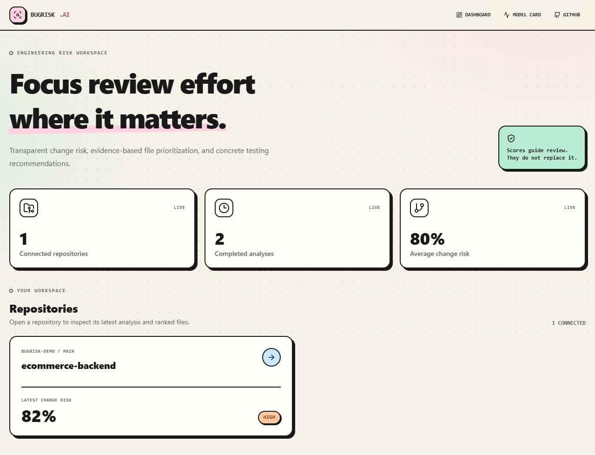

# BugRisk AI

BugRisk AI is an explainable engineering-risk dashboard for Python repositories. It estimates the defect risk of an analyzed **commit/change** and derives a separate **file-priority score** to help reviewers and QA engineers decide where to focus. A file-priority score is a review aid, not a claim that the file contains a bug.

## Features

- **Dashboard:** responsive Next.js 16 interface for repositories, pull requests, file evidence, analysis history, and model information.
- **API and authentication:** FastAPI REST API, GitHub OAuth, encrypted server-side access tokens, secure sessions, and repository ownership checks.
- **Analysis worker:** database-backed analysis states and a separate worker process for queued work.
- **Repository analysis:** temporary authenticated Git clones and Python-oriented features derived from Git history, AST analysis, and Radon.
- **Defect prediction:** ApacheJIT preprocessing, temporal per-project evaluation splits, model comparison, probability calibration, SHAP explanations, MLflow logging, and DVC pipeline stages.
- **Evidence-based recommendations:** deterministic recommendations grounded in analysis evidence. An LLM does not generate risk scores.
- **Pull-request automation:** signed GitHub App webhooks for pull-request events, changed-Python-file analysis, and reusable report comments.
- **Storage options:** SQLite for a zero-configuration demo; PostgreSQL/Supabase schema and row-level security (RLS) policies for deployment.
- **Deployment support:** Docker Compose, Render, Vercel, and GitHub Actions configuration.

The CodeBERT, GRU-history, and GNN-dependency components are available as **offline research/training pipelines**. The current fusion-training implementation uses CodeBERT vectors and GRU history representations, but supplies zero-filled GNN vectors; it should therefore **not** be described as a fully integrated, trained CodeBERT + GRU + GNN predictor. These experiments do not replace the live API prediction path.

## Interface preview

| Landing page | Repository dashboard |
| --- | --- |
|  |  |

[View the mobile preview](preview-redesign-mobile.png)

## Quick start: demo mode

### Requirements

- Python 3.11+
- Node.js 22+
- pnpm 11+
- Git

### 1. Configure the environment

From the repository root, create a local environment file:

```powershell
Copy-Item .env.example .env
```

Keep `DEMO_MODE=true` for the local demo. The demo seeds a completed example analysis and does not require GitHub credentials.

### 2. Start the API

In a terminal:

```powershell
Set-Location backend
python -m venv .venv
.\.venv\Scripts\Activate.ps1
pip install -e ".[dev]"
uvicorn app.main:app --reload
```

The API and interactive documentation are available at `http://localhost:8000` and `http://localhost:8000/docs`.

### 3. Start the frontend

In a second terminal, from the repository root:

```powershell
Set-Location frontend
corepack pnpm install
corepack pnpm dev
```

Open `http://localhost:3000/dashboard`.

## Train the ApacheJIT baseline model

BugRisk AI uses the ApacheJIT v2 dataset, downloaded from [Zenodo record 5907847](https://zenodo.org/records/5907847). The archive contains `apachejit_total.csv`; its `buggy` column is the commit-level target.

From the repository root:

```powershell
pip install -e ".\backend[ml]"
dvc repro
```

The DVC stages download and prepare the dataset, normalize features, split projects in temporal 60/20/20 order, compare Logistic Regression, Random Forest, and XGBoost, calibrate the selected model, and export `ml/artifacts/bugrisk_model.joblib`.

A recall-aware F2 operating threshold is selected on validation data for evaluation reporting. The API returns calibrated probabilities and uses the product's fixed risk bands. DVC tracks dataset and pipeline hashes; MLflow records the selected model and test metrics when installed.

## GitHub OAuth

Create a GitHub OAuth App and set its callback URL to:

```text
http://localhost:8000/auth/github/callback
```

Configure `GITHUB_CLIENT_ID`, `GITHUB_CLIENT_SECRET`, a random `SESSION_SECRET` of at least 32 characters, and a Fernet `TOKEN_ENCRYPTION_KEY`. Disable demo mode when enabling authenticated use.

Access tokens are encrypted before storage. They are not sent to the frontend or placed in Git command arguments.

## GitHub Pull Request automation

Create a GitHub App with webhook URL `https://<backend>/webhooks/github`. Enable the **Pull request** event and grant read access to repository metadata and contents, plus read/write access to pull requests.

Configure `GITHUB_APP_ID`, `GITHUB_APP_PRIVATE_KEY`, and `GITHUB_WEBHOOK_SECRET`, then install the app on a connected repository. The `opened` and `synchronize` events queue analyses limited to the pull request's changed Python files. BugRisk AI posts one report comment and updates it on later pushes.

## Offline model research

These optional experiments explore whether source semantics, file history, and dependency structure improve defect prediction beyond conventional Git/code metrics. They are research workflows and do not change the live `/predict` path.

### CodeBERT source embeddings

Install the CodeBERT dependencies:

```powershell
pip install -e ".\backend[codebert]"
```

Extract source files for selected ApacheJIT projects, embed them, and train/evaluate a metrics-plus-embedding model:

```powershell
python -m ml.embeddings.extract --data ml/data/processed/apachejit.csv `
    --projects apache/zookeeper,apache/spark,apache/hadoop-mapreduce,apache/hadoop-hdfs,apache/kafka `
    --output ml/data/codebert/sources

python -m ml.embeddings.embed --sources ml/data/codebert/sources/sources.parquet `
    --output ml/data/codebert/embeddings

python -m ml.training.train_codebert --data ml/data/processed/apachejit.csv `
    --embeddings ml/data/codebert/embeddings/embeddings.npz `
    --output ml/artifacts/codebert
```

The extraction stage clones public Apache GitHub mirrors (cached under `~/.cache/bugrisk/repos`) and records source files associated with dataset commits. The embedding stage creates content-hash-cached CodeBERT vectors. The training stage compares a metrics-plus-embedding MLP with metrics-only XGBoost using the same rows and evaluation protocol. See [the CodeBERT research notes](docs/research/codebert-vs-metrics.md).

### GRU history and GNN dependency experiments

The repository also includes GRU-based history modeling and GraphSAGE-based dependency-graph modeling code under `ml/models/`, `ml/pipeline/`, and `ml/training/`. These are optional research components and may require additional PyTorch/PyTorch Geometric dependencies and prepared file-level data. Install the optional fusion dependencies with:

```powershell
pip install -e ".\backend[fusion]"
```

Prepare the appropriate file dataset, history sequences, dependency graphs, and CodeBERT embeddings before running the corresponding training modules. Check each module's CLI help and the pipeline scripts for the required input paths. The current `train_fusion` code uses zero-filled GNN vectors, so its output is not evidence of a trained GNN contribution.

## Supabase / PostgreSQL

Create a Supabase project, open its SQL editor, and apply the SQL files in `backend/supabase/migrations` in numeric order. Set `DATABASE_URL` to the pooled PostgreSQL connection string used by the API and worker.

The migrations define ownership-oriented RLS policies for application tables. The API also performs explicit ownership checks. SQLite remains the default for the zero-config demo.

## Docker Compose

After creating `.env`, run:

```powershell
docker compose up --build
```

Compose starts PostgreSQL, the API, worker, and frontend. `INLINE_WORKER=false` ensures that only the separate worker consumes queued analyses.

## Quality checks

From the repository root, run the Python checks:

```powershell
python -m ruff check backend ml scripts
python -m mypy --config-file backend/pyproject.toml --explicit-package-bases backend/app ml
python -m pytest backend/tests ml/tests --cov=backend/app
```

Then run the frontend checks:

```powershell
Set-Location frontend
corepack pnpm lint
corepack pnpm typecheck
corepack pnpm test
corepack pnpm build
```

## Documentation

- [Architecture](docs/architecture.md)
- [Deployment](docs/deployment.md)
- [Security policy](SECURITY.md)
- [CodeBERT research notes](docs/research/codebert-vs-metrics.md)
